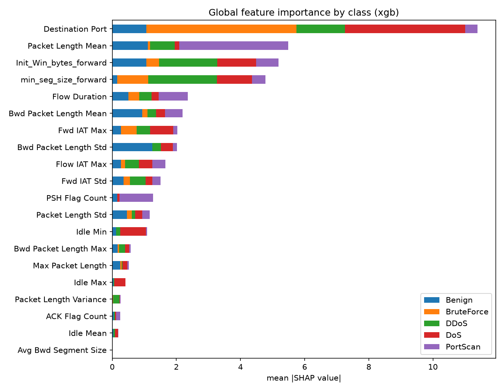

# FlowSight: Explainable Machine-Learning Network Intrusion Detection

**Final project report**

*Author:* [Your name] · *Programme / course:* [Course name] · *Institution:* [Institution] ·
*Date:* [Submission date]
*Code:* https://github.com/gaurvit06/FLOWSIGHT

---

## Abstract

FlowSight is a network intrusion detection system (NIDS) that classifies network flows as
**Benign, DDoS, DoS, PortScan or BruteForce** using supervised machine learning, and explains
every alert to a human analyst. Random Forest, XGBoost and a linear Support Vector Machine
were trained on the full CIC-IDS2017 benchmark (2.83 million flows, all eight capture days)
under a strict leakage-controlled protocol: identifiers removed, duplicates removed before
splitting, a 70/15/15 train/validation/test split, and model selection on validation only.
The selected model, XGBoost, reaches a **macro-F1 of 0.9979** on 377,499 held-out test flows
with a **false positive rate of 0.07%** and **1.7 ms** per-flow latency; five-fold
cross-validation agrees (0.996 ± 0.002).

Beyond classification, FlowSight adds analyst-facing features rarely found in student NIDS
projects: plain-English alert stories derived from SHAP explanations, severity scoring,
incident grouping, an unknown-attack rule, a what-if explorer, an analyst feedback loop and a
drift monitor, served through a FastAPI service and a Streamlit console. The report is
deliberately honest about weaknesses: on attacks the model has never seen, detection is
poor for DoS (5%) and PortScan (1%), and a port-removal ablation quantifies how much the model
relies on Destination Port (macro-F1 drops only from 0.9964 to 0.9938).

---

## 1. Introduction

Networks face volumetric floods (DDoS/DoS), reconnaissance (port scans) and credential
attacks (brute force) continuously. Signature-based IDS such as Snort and Suricata match
hand-written rules: precise for known patterns, blind to variants, and costly to maintain.
Machine-learning IDS learn the statistical shape of attacks from labelled traffic instead,
but they bring two problems of their own:

1. **Inflated results.** Public datasets contain duplicates and identifying fields, so
   models can reach "99.9%" by memorising rather than generalising.
2. **Opacity.** An alert that says only "ATTACK" is hard for an analyst to trust or act on.

FlowSight addresses both: a leakage-controlled evaluation protocol with honest reporting of
weaknesses, and an explanation layer that turns every alert into a sentence an analyst can
read.

## 2. Objectives

| # | Objective | Status |
|---|---|---|
| O1 | Classify flows into Benign, DDoS, DoS, PortScan, BruteForce | ✅ macro-F1 0.9979 (test) |
| O2 | Compare Random Forest, SVM and XGBoost fairly | ✅ same split, CV, validation-based choice |
| O3 | Use feature selection, and study its effect | ✅ 20 of 70 features; three-method study |
| O4 | Explain every prediction (explainable AI) | ✅ SHAP + plain-English stories |
| O5 | Analyst dashboard for traffic, threats and model performance | ✅ 7-page console |
| O6 | Go beyond accuracy: unknown attacks, robustness, honesty | ✅ zero-day and port ablations |

---

## 3. Dataset

**CIC-IDS2017** [1] was captured by the Canadian Institute for Cybersecurity over five
working days on a testbed with benign user activity and scripted attacks. FlowSight uses the
official *MachineLearningCSV* release: 8 CSV files, flows extracted by CICFlowMeter with 78
statistical features each. Files were verified with SHA-256 checksums
(`data/raw/CHECKSUMS.sha256`); the full audit is in `reports/DATASET.md`.

### 3.1 Data quality (raw)

| Issue | Count |
|---|---|
| Raw flows | 2,830,743 |
| Infinite values (rate features divided by zero duration) | 4,376 cells |
| Exact duplicate rows | 256,479 |
| Constant (zero-variance) features | 8 |

### 3.2 Label mapping and cleaning

The 15 raw labels were mapped to five classes: all `DoS *` variants → **DoS**;
`FTP-Patator`/`SSH-Patator` → **BruteForce**. Bot, Web Attack (3 kinds), Infiltration and
Heartbleed (4,193 flows in total) are too small for reliable per-class evaluation and were
excluded. Cleaning then removed infinite/missing values, constant columns and duplicates
(duplicates *before* splitting, so no flow appears in both training and test).

| Step | Result |
|---|---|
| Raw flows | 2,830,743 |
| After cleaning | **2,516,660** (11.1% removed, mostly duplicates) |
| Features kept | 70 |

### 3.3 Final class balance

| Class | Flows | Share |
|---|---:|---:|
| Benign | 2,095,057 | 83.25% |
| DoS | 193,745 | 7.70% |
| DDoS | 128,014 | 5.09% |
| PortScan | 90,694 | 3.60% |
| BruteForce | 9,150 | **0.36%** |

The data is heavily imbalanced. A model that never raises an alert would score 83% accuracy,
so **accuracy is not used to choose models**; macro-F1 (every class weighted equally) and
per-class recall are.

---

## 4. Methodology

### 4.1 Leakage controls

* **Identifiers removed.** Flow ID, IP addresses, source port and timestamp would let a model
  learn *who/when* rather than *how*. (The MachineLearningCSV release already omits them; the
  cleaning code removes them if present.)
* **Duplicates removed before splitting.**
* **All preprocessing inside one scikit-learn Pipeline** (scaling → feature selection →
  classifier), fitted on training data only. The identical saved pipeline is used for
  serving, so training and production cannot drift apart.

### 4.2 Evaluation protocol

* Stratified **70 / 15 / 15** split into train / validation / test (seed 42).
* **Every decision uses training or validation data**: model choice, number of features,
  imbalance strategy, feature-selection method. The test set (377,499 flows) is used **once**
  for the reported numbers.
* Training rows were capped at a stratified 600,000 to fit a 16 GB laptop; validation and
  test remain full size, so reported numbers are unaffected.
* Five-fold stratified cross-validation on training data for mean ± std estimates.

### 4.3 Models

| Model | Configuration | Imbalance handling |
|---|---|---|
| Random Forest [2] | 200 trees, unlimited depth | `class_weight="balanced_subsample"` |
| XGBoost [3] | 300 rounds, depth 8, learning rate 0.1, histogram method | class weights = balanced^0.5 |
| Linear SVM | LinearSVC, calibrated for probabilities, ≤200k rows | `class_weight="balanced"` |

A kernel (RBF) SVM is O(n²) and does not finish on millions of flows; the linear SVM is the
practical form of "SVM" at this scale.

### 4.4 Feature selection

20 of 70 features are kept by **ExtraTrees importance**, computed once on the training data
(`TreeTopK`). This replaced the initial ANOVA F-test after real-data validation (Section 6.6).
The 20 selected features include Destination Port, flow duration, packet-length statistics,
inter-arrival times, TCP window and segment sizes, and idle times.

### 4.5 Explainability

For tree models, **SHAP** TreeExplainer [4] gives each feature's contribution to the predicted
class for every alert. FlowSight then compares the flow's **raw** values with percentiles of
benign training traffic and writes a plain-English story, for example:

> *Flagged as DDoS (100% confident): packets received was unusually low at 1.0 (normal median
> 10.0); packet rate was 56,827 packets/s, 1,133× the normal median (higher than 99% of
> normal traffic); and average outgoing packet size was unusually low at 99.7.*

Stories are template-based rather than generated by a language model, so they are
deterministic, testable and never invent numbers. When no single feature is unusual, the story
says so instead of listing a normal value.

### 4.6 Unknown-attack rule

A classifier can only output classes it was trained on. A flow the classifier labels Benign is
re-labelled **Unknown-Anomaly** if either:

1. an **Isolation Forest** [5] trained on benign flows only (plus a range rule: any feature
   more than 10× beyond anything seen in benign traffic) marks it as anomalous, or
2. the classifier is **less than 90% sure** it is benign.

### 4.7 Analyst features

| Feature | How it works |
|---|---|
| Severity | base(type) × confidence × burst factor → Low / Medium / High / Critical (`configs/severity.yaml`) |
| Incidents | Alerts of the same type less than 120 s apart are grouped into one incident with a timeline |
| What-if explorer | Sliders change a flow's top features; the verdict is recomputed live |
| Feedback loop | Analysts mark alerts confirmed or false positive; measured precision; export for retraining |
| Drift monitor | Population Stability Index of recent traffic against training histograms; warning above 0.2 |

---

## 5. System design and implementation

```
flows (replay / CSV upload / live CICFlowMeter)
        │
        ▼
FastAPI ─► pipeline (scale → select 20 → XGBoost) ─► SHAP ─► story ─► severity
        ├► unknown-attack rule (Isolation Forest + range rule + confidence)
        ├► SQLite: predictions · incidents · analyst feedback
        └► drift monitor (PSI)
                 │
                 ▼
Streamlit SOC console: Overview · Incidents · Investigate · Models · Feedback ·
                       Analyse File · Method & Limits
```

* **Language and libraries:** Python 3.12, pandas, scikit-learn, XGBoost, SHAP, FastAPI,
  Streamlit, Plotly, SQLite.
* **Console:** a terminal-style security-operations interface with shell-prompt page headers,
  log-style alert entries with severity tags, KPI tiles and a status bar.
* **Quality:** 52 automated tests (cleaning invariants, pipeline, stories, severity, storage,
  drift, the unknown-attack rule, API contract, dataset fetching), linting with Ruff, and a
  **quality gate** that fails the build if macro-F1 drops below 0.90 or any attack class's
  recall drops below 0.90. GitHub Actions runs everything on every push.
* **Reproducibility:** fixed seeds; dataset checksums; every report regenerated by a script;
  decision log in `DECISIONS.md` (D1–D17).
* **Public demo:** `scripts/run_demo.ps1` streams real CIC-IDS2017 flows into the API and
  publishes the console over an HTTPS tunnel in a restricted demo mode (no history deletion,
  no exports, small uploads only). The API itself is never exposed.

---

## 6. Results

All numbers are on CIC-IDS2017. Test-set figures use the 377,499-flow held-out split.

### 6.1 Model comparison (held-out test set)

| Model | Validation macro-F1 | **Test macro-F1** | Test accuracy | False positive rate | Latency / flow |
|---|---:|---:|---:|---:|---:|
| **XGBoost** (selected) | 0.9976 | **0.9979** | 0.9993 | **0.07%** | **1.7 ms** |
| Random Forest | 0.9973 | 0.9978 | 0.9993 | 0.06% | 26.8 ms |
| Linear SVM | 0.6734 | 0.6754 | 0.9443 | 1.81% | 2.0 ms |

XGBoost was selected on validation macro-F1. It ties Random Forest on accuracy but is 16×
faster per flow and its model file is 9× smaller (3.4 MB vs 30.5 MB).

### 6.2 Cross-validation (5-fold, 200,000 training flows)

| Model | Macro-F1 | Lowest attack-class recall | False positive rate |
|---|---|---|---|
| Random Forest | 0.9962 ± 0.0017 | 0.9908 ± 0.0039 | 0.08% ± 0.04% |
| XGBoost | 0.9960 ± 0.0020 | 0.9912 ± 0.0043 | 0.10% ± 0.05% |
| Linear SVM | 0.6667 ± 0.0074 | **0.0000** | 1.88% ± 0.04% |

The tree models are stable across folds. The linear SVM **never detects PortScan**: port
scans are not linearly separable from benign traffic in this feature space.

### 6.3 Per-class performance (XGBoost, test set)

| Class | Precision | Recall | F1 | Test flows |
|---|---:|---:|---:|---:|
| Benign | 0.9999 | 0.9993 | 0.9996 | 314,259 |
| BruteForce | 0.9964 | 0.9993 | 0.9978 | 1,372 |
| DDoS | 0.9993 | 0.9997 | 0.9995 | 19,202 |
| DoS | 0.9979 | 0.9991 | 0.9985 | 29,062 |
| PortScan | 0.9894 | 0.9993 | 0.9943 | 13,604 |

The weakest cell is PortScan precision (0.989): some benign flows look like single
scan probes.

### 6.4 Explainability: what the model relies on

Mean absolute SHAP values per class (`reports/shap_global.md`, figures in `reports/figures/`):

| Class | Top three features |
|---|---|
| BruteForce | Destination Port, min_seg_size_forward, Fwd IAT Max |
| DDoS | min_seg_size_forward, Init_Win_bytes_forward, Destination Port |
| DoS | Destination Port, Init_Win_bytes_forward, min_seg_size_forward |
| PortScan | Packet Length Mean, PSH Flag Count, Flow Duration |



Destination Port is the top feature for two classes. Since an attacker can change ports,
this was tested directly (6.5).

### 6.5 Robustness: Destination Port ablation

XGBoost retrained without Destination Port (same training sample, validation split):

| | Macro-F1 | BruteForce recall | DoS recall | DDoS recall | PortScan recall |
|---|---:|---:|---:|---:|---:|
| With port | 0.9964 | 0.9931 | 0.9994 | 0.9985 | 0.9972 |
| **Without port** | **0.9938** | 0.9793 | 0.9981 | 0.9975 | 0.9972 |

Removing the port costs only 0.26 points of macro-F1, and the largest drop (BruteForce,
−1.4 points of recall) still leaves 97.9% recall. **The model recognises attacks mainly from
traffic behaviour, not just the port number**, so an attacker moving to a non-standard port
would not simply bypass it.

### 6.6 Findings from real data that changed the design

The first real-data training run exposed problems that synthetic test data had hidden:

| Problem (first real run) | Evidence | Fix | Result |
|---|---|---|---|
| ANOVA F feature selection dropped Destination Port and kept near-duplicate packet-length features | XGBoost test macro-F1 **0.883** | ExtraTrees-importance selection (D15) | 0.998 |
| Fully balanced class weights made XGBoost over-predict BruteForce | BruteForce precision **0.29**, recall 0.98 | Weights = balanced^0.5 (D14) | BruteForce F1 0.998 |
| Feature selector recomputed importances on every prediction | 41 ms per flow | Store the mask at fit time (`TreeTopK`) | 1.7 ms per flow |
| Benign-only Isolation Forest barely fires on real attacks | flags < 0.05% of attacks | Add classifier-confidence rule (D17) | See 6.8 |

Validation-split comparison that drove the first two fixes (300,000 training flows):

| Configuration | Validation macro-F1 | BruteForce F1 |
|---|---:|---:|
| XGBoost, ANOVA, balanced weights | 0.8895 | 0.487 |
| XGBoost, ANOVA, √ weights | 0.9898 | 0.971 |
| **XGBoost, tree selection, √ weights** | **0.9978** | **0.998** |
| Random Forest, tree selection | 0.9972 | 0.996 |

### 6.7 Feature selection and imbalance studies

**Number of features** (XGBoost, validation macro-F1, `reports/feature_selection.md`):

| k | ANOVA F | Mutual information | RF importance |
|---:|---:|---:|---:|
| 5 | 0.621 | 0.970 | 0.972 |
| 10 | 0.879 | 0.975 | 0.977 |
| 20 | 0.931 | 0.994 | 0.979 |
| 40 | 0.996 | 0.996 | 0.996 |
| 70 (all) | 0.996 | 0.996 | 0.996 |

Non-linear rankings reach near-maximum accuracy with far fewer features than ANOVA F. With
20 well-chosen features the model loses nothing measurable against all 70, while
explanations stay short and readable.

**Imbalance strategy** (XGBoost with tree selection, validation): none 0.9960, class
weights 0.9955, SMOTE [6] (applied inside training only) 0.9962. Once feature selection was
fixed, the three strategies perform within noise of each other; softened weights were kept as
a safeguard for the rarest class.

### 6.8 Unknown attacks

**On the test set:** the classifier labelled 33 attack flows Benign. The unknown-attack rule
recovered **66.7%** of them at a cost of **0.51%** of benign flows becoming alerts.

**On attacks the model has never seen** (leave-one-attack-out: retrain without one attack
class, then send that class's test flows through classifier and rule):

| Held-out attack | Caught by classifier (as another attack) | Added by unknown-attack rule | Total caught |
|---|---:|---:|---:|
| DDoS | 60.3% | 2.7% | **63.0%** |
| BruteForce | 13.3% | 9.0% | 22.3% |
| DoS | 1.5% | 3.8% | 5.3% |
| PortScan | 0.6% | 0.3% | 0.9% |

Mean benign false-alarm rate of the rule: 0.64%.

This is the project's most important negative result. Flow-by-flow, an unseen DoS or port
scan usually looks like ordinary traffic; DDoS generalises because its flows resemble DoS.
**FlowSight should not be described as detecting zero-day attacks in general**; it catches
some, and reports clearly which.

### 6.9 End-to-end check

600 real CIC-IDS2017 flows were streamed through the running API: 99.7% agreed with the
ground-truth labels, producing 182 alerts grouped into 5 incidents, with the drift monitor
reporting traffic consistent with training.

---

## 7. Discussion

* **Rigour changed the results more than model choice did.** The tree models are nearly
  identical. The decisive factors were the feature-selection method and the class weighting,
  both found only by evaluating on real data and inspecting per-class numbers rather than
  accuracy.
* **High scores need context.** 0.998 macro-F1 on CIC-IDS2017 coexists with near-zero
  detection of unseen DoS and PortScan. Both are true; reporting only the first would
  mislead.
* **Explanations are a product feature, not decoration.** The SHAP analysis surfaced the
  Destination Port question, the ablation answered it, and the stories let a non-expert read
  why each alert fired.

## 8. Limitations

1. **One dataset, one testbed.** CIC-IDS2017 is a 2017 lab capture. The cross-dataset script
   (train on 2017, test on CSE-CIC-IDS2018) is implemented but was not run in this project;
   cross-dataset accuracy is expected to be substantially lower.
2. **Known label noise.** Published analyses report labelling and flow-construction issues in
   CIC-IDS2017 [7]; some "errors" may be label errors.
3. **Excluded classes.** Bot, Web attacks, Infiltration and Heartbleed were left out because of
   their tiny size.
4. **Flow-level only.** No payload inspection, and detection happens only after a flow ends.
5. **Adversarial evasion** was not evaluated; an attacker who knows the features can shape
   traffic.
6. **Training cap.** 600,000 of about 1.76 million training flows were used, a memory
   constraint.
7. **Live capture** (CICFlowMeter bridge) and the Docker deployment are implemented but were
   not tested end-to-end.

## 9. Future work

* Run the cross-dataset evaluation on CSE-CIC-IDS2018 and add domain-adaptation experiments.
* Sequence-level detection (grouping flows by host over time) for scans and slow DoS, the
  classes flow-level models miss when unseen.
* Retrain from analyst feedback automatically when the drift monitor fires.
* Adversarial robustness testing (feature-space perturbations within protocol constraints).
* Test the live-capture bridge in an isolated two-VM lab.

## 10. Conclusion

FlowSight meets its objectives: on 377,499 unseen CIC-IDS2017 flows the selected XGBoost model
reaches 0.9979 macro-F1 with a 0.07% false positive rate at 1.7 ms per flow. Every alert comes
with a SHAP-based explanation, a plain-English story, a severity and an incident. Just as
importantly, the project measures where the approach breaks: unseen DoS and port scans are
largely missed. That boundary is the clearest direction for future work.

---

## References

[1] I. Sharafaldin, A. H. Lashkari, A. A. Ghorbani. "Toward Generating a New Intrusion
Detection Dataset and Intrusion Traffic Characterization." *ICISSP*, 2018.
[2] L. Breiman. "Random Forests." *Machine Learning* 45, 2001.
[3] T. Chen, C. Guestrin. "XGBoost: A Scalable Tree Boosting System." *KDD*, 2016.
[4] S. M. Lundberg, S.-I. Lee. "A Unified Approach to Interpreting Model Predictions."
*NeurIPS*, 2017.
[5] F. T. Liu, K. M. Ting, Z.-H. Zhou. "Isolation Forest." *IEEE ICDM*, 2008.
[6] N. V. Chawla, K. W. Bowyer, L. O. Hall, W. P. Kegelmeyer. "SMOTE: Synthetic Minority
Over-sampling Technique." *JAIR* 16, 2002.
[7] G. Engelen, V. Rimmer, W. Joosen. "Troubleshooting an Intrusion Detection Dataset: the
CICIDS2017 Case Study." *IEEE Security and Privacy Workshops*, 2021.

---

## Appendix A: Reproducing every number

```powershell
python -m uv venv --python 3.12 .venv
python -m uv pip install --python .venv\Scripts\python.exe -e ".[dev]"
python scripts/fetch_dataset.py --zip <MachineLearningCSV.zip>
python scripts/audit_dataset.py                 # Section 3
python -m nids.models.train --rebuild           # 6.1, 6.3, 6.8 (test set)
python scripts/model_card.py
python scripts/cv_report.py                     # 6.2
python scripts/shap_global.py                   # 6.4
python scripts/port_ablation.py                 # 6.5
python scripts/feature_selection_study.py       # 6.7
python scripts/imbalance_ablation.py            # 6.7
python scripts/zero_day_experiment.py           # 6.8
pytest                                          # quality gate
```

## Appendix B: Supporting documents in the repository

| Document | Contents |
|---|---|
| `reports/DATASET.md` | Per-file audit, checksums, cleaning log |
| `reports/MODEL_CARD.md` | Intended use, performance, limitations |
| `reports/*.md`, `reports/figures/` | Every experiment's full tables and plots |
| `DECISIONS.md` | 17 design decisions with evidence |
| `BUILD.md` | Build plan and status |
