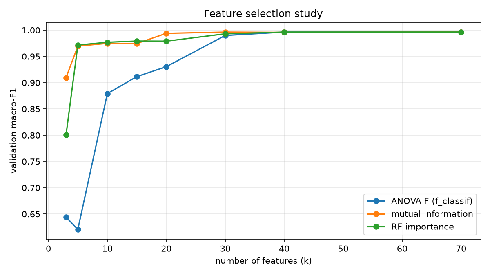

# Feature selection study

| k | ANOVA F (f_classif) | mutual information | RF importance |
|---|---|---|---|
| 3 | 0.6441 | 0.9096 | 0.8007 |
| 5 | 0.6207 | 0.9696 | 0.9716 |
| 10 | 0.8791 | 0.9748 | 0.9769 |
| 15 | 0.9116 | 0.9745 | 0.9792 |
| 20 | 0.9305 | 0.9939 | 0.9790 |
| 30 | 0.9899 | 0.9963 | 0.9930 |
| 40 | 0.9963 | 0.9958 | 0.9963 |
| 70 | 0.9964 | 0.9964 | 0.9964 |

Top 10 by RF importance: Bwd Packet Length Std, Bwd Packet Length Mean, Packet Length Variance, Average Packet Size, Total Length of Bwd Packets, Avg Bwd Segment Size, Max Packet Length, Packet Length Mean, Total Length of Fwd Packets, Subflow Fwd Bytes