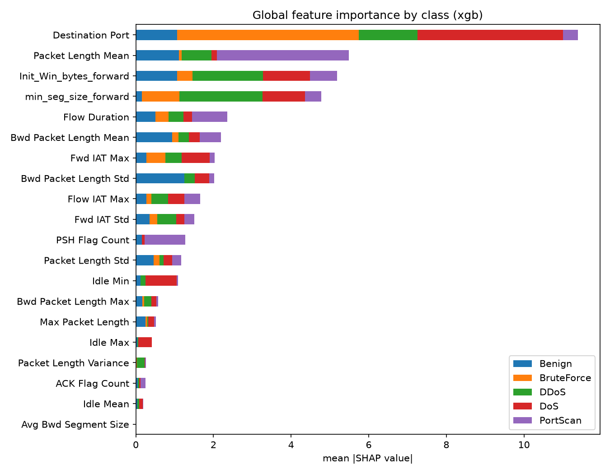
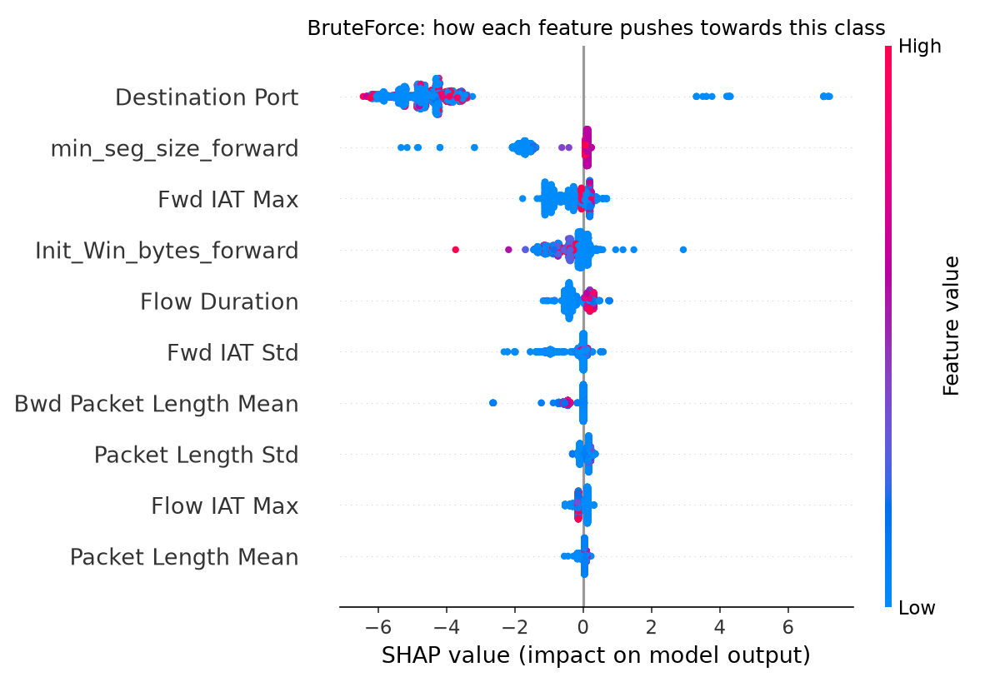
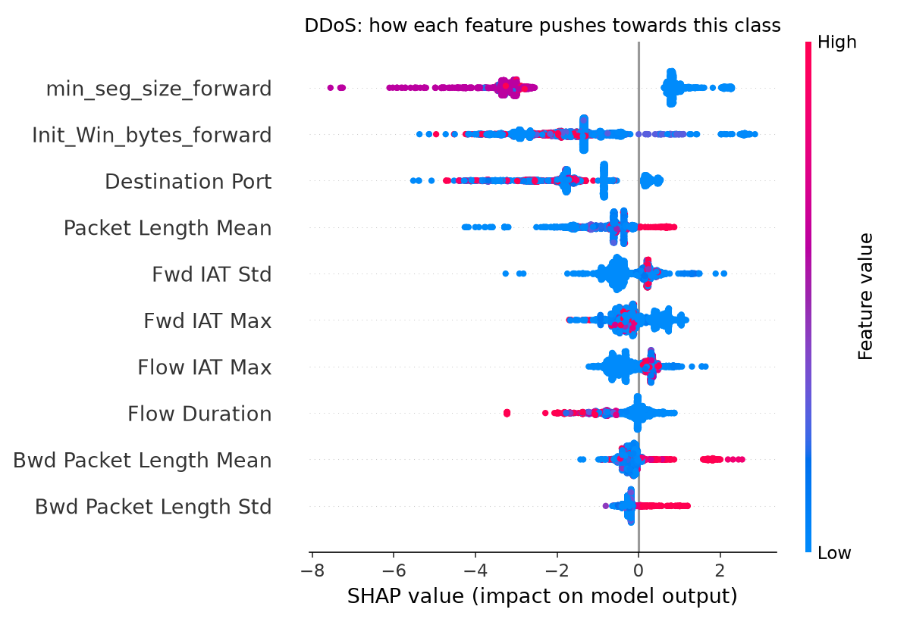
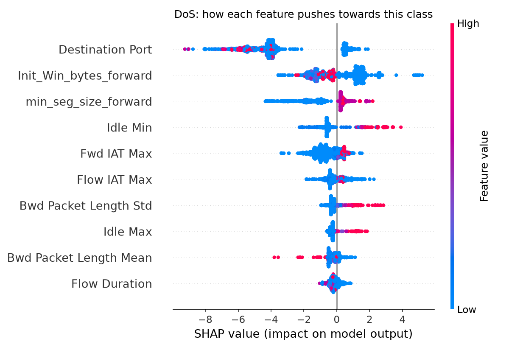
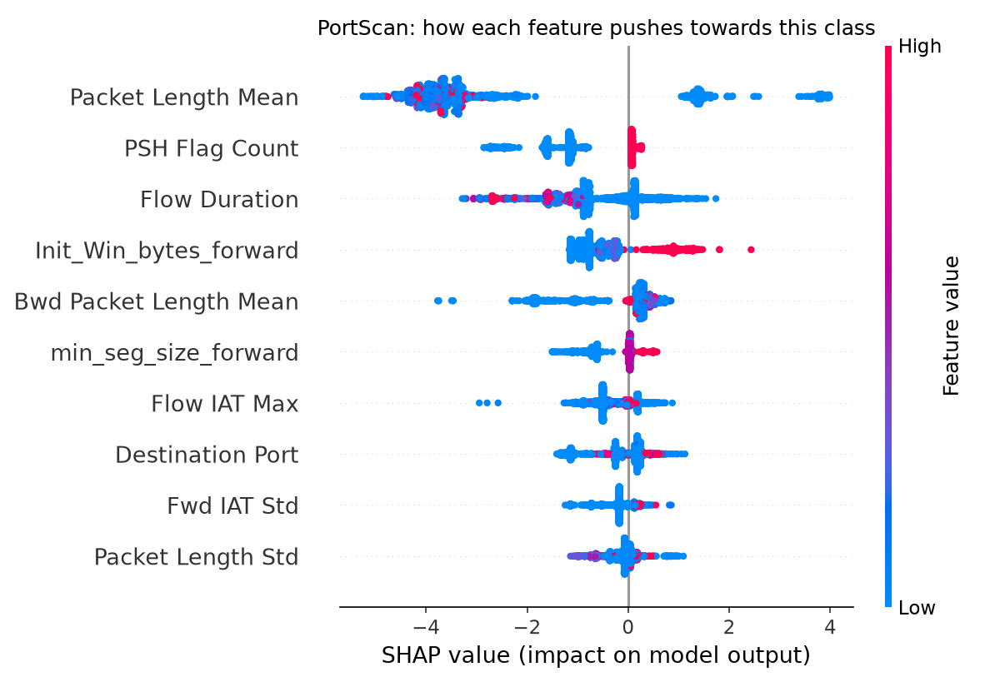

# Global SHAP importance

## BruteForce
Top features: Destination Port, min_seg_size_forward, Fwd IAT Max

## DDoS
Top features: min_seg_size_forward, Init_Win_bytes_forward, Destination Port

## DoS
Top features: Destination Port, Init_Win_bytes_forward, min_seg_size_forward

## PortScan
Top features: Packet Length Mean, PSH Flag Count, Flow Duration

